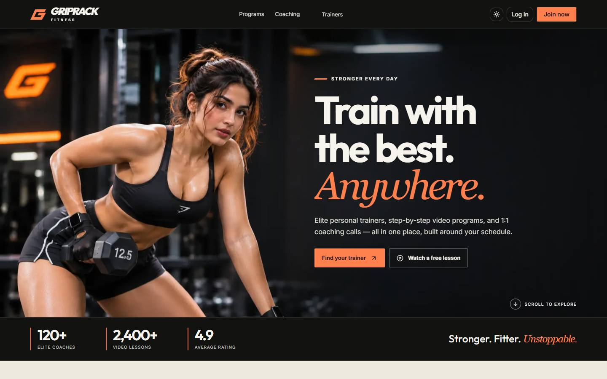
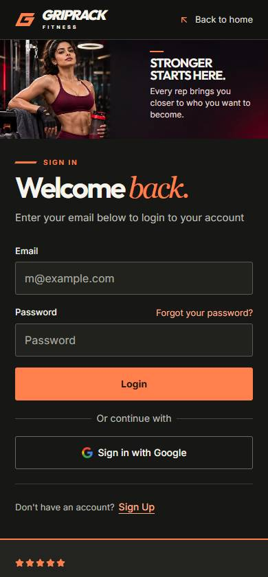

# GRIPRACK Fitness

**A full-stack fitness coaching and management platform**

Developed and maintained for GRIPRACK Fitness by **Singh Rajdiwakar**.

A client can find a coach, preview a lesson, and buy a video program or book a one-to-one call. On the other side of that transaction, the trainer can publish lessons, offer appointment times, message clients, and see the sale in their dashboard.

[Screenshots](#screenshots) · [Local installation](#local-installation) · [Environment variables](#environment-variables) · [Stripe payments](#stripe-payments) · [Available scripts](#available-scripts)

## Project overview

GRIPRACK Fitness has two account roles. **Clients** use the public directory and their personal library. **Trainers** have a public profile and a private workspace for programs, clients, bookings, and gross sales. Visitors can explore published programs and try the first lesson before registering.

## Key features

| Area | What the application does |
| --- | --- |
| Accounts | Email/password sign-in, Google sign-in through Neon Auth, password recovery, and role-based onboarding. Trainers enter a headline, biography, specialties, and session price. |
| Discovery and reviews | Filter trainers by specialty, open a profile, compare programs and available slots, and read ratings. A purchase from a trainer makes the buyer eligible for one editable review of that trainer. |
| Programs and lessons | Trainers create drafts, upload a cover and lesson videos, set a USD price, and publish after adding at least one lesson. The first lesson is a preview. The owner and purchasers can access the full curriculum. |
| Library and bookings | Clients find purchased programs, upcoming calls, and pending checkouts in their library. A session slot is held while checkout is open. |
| Chat and calls | Direct messages support client–trainer and trainer–trainer conversations. A booked slot has a one-to-one video room for its client and trainer. |
| Trainer workspace | Manage programs, availability and clients. The overview shows gross sales, an eight-week revenue chart, upcoming sessions, average rating, and a live sales feed. |

## Technology stack

| Layer | Implementation |
| --- | --- |
| Application | Next.js 16.4.5 App Router, React 19.3.0, TypeScript |
| Presentation | Tailwind CSS v4, Base UI, Lucide icons, CSS transitions and animations, and Intersection Observer for homepage reveals |
| Data and identity | Neon PostgreSQL, Drizzle ORM with the `pg` driver, Drizzle Kit migrations, Neon Auth, Neon Realtime |
| Commerce | Stripe Checkout, Stripe Connect destination charges, signed Stripe webhooks |
| Coaching and media | Stream Chat and Video, ImageKit uploads, image delivery and video playback |
| Validation and diagnostics | Zod, Sentry for Next.js, ESLint, Node's built-in test runner |

## Application architecture

Next.js serves both the interface and the server-side application. Server components read data for a page. Server actions handle operations such as publishing a program or starting checkout. Browser components handle the chat composer, video devices, media player, and realtime subscriptions.

| Boundary | How data moves |
| --- | --- |
| Identity → profile | Neon Auth supplies the session. The server looks up the matching PostgreSQL profile and checks the role or ownership required by the action. |
| Application → database | Drizzle reads and writes profiles, programs, lessons, slots, purchases, pending checkouts, and reviews. The runtime uses a pooled connection. Migrations use a direct connection. |
| Checkout → fulfillment | The server creates a hosted Stripe session. The signed webhook and authenticated return route use the same fulfillment function. |
| Server → live clients | Neon Realtime distributes scoped sales and slot updates. Stream uses a short-lived user token issued by the server for messaging and calls. |
| Browser → media | The server authorizes an upload or checks access to a lesson. The browser uploads or plays media through ImageKit. |

## Screenshots



<details>
<summary>View the mobile sign-in screen</summary>



</details>

Both captures show public, signed-out screens. Private conversations, client records, bookings, and financial activity are excluded from this gallery.

## Local installation

Use the GRIPRACK working copy that contains this README and its lockfile. The following PowerShell example uses the existing Windows project location. The repository checks were run with Node.js 25.2.1 and npm 11.17.0.

1. **Install dependencies.** From the project root, install the versions in the lockfile.

   ```powershell
   Set-Location -LiteralPath 'D:\project\GRIPRACK Fitness'
   npm ci
   ```

2. **Configure the development environment.** Create the local file only if it does not already exist, then fill in your development service values privately.

   ```powershell
   if (!(Test-Path -LiteralPath .env.local)) { Copy-Item -LiteralPath .env.example -Destination .env.local }
   ```

3. **Prepare a development database.** Obtain pooled and direct URLs for the same Neon branch. Enable Neon Auth for that branch. For live slots and sales, configure Neon Realtime and allow the local app origin. For a new, empty development branch, review the SQL in [drizzle/](drizzle/) and apply the checked-in migrations:

   ```powershell
   npm run db:migrate
   ```

   Skip this step for an already-migrated database. Seeding is optional and replaces existing fixture profiles and their related rows. Use it only on a disposable development database with its own Auth users.

4. **Start the application.**

   ```powershell
   npm run dev
   ```

   Open **http://localhost:3000**. Configure Stripe Sandbox for checkout, a Stream app with Chat and a members-only `session` video call type for coaching, and ImageKit for media uploads and playback. Google sign-in also requires the provider to be enabled in Neon Auth.

## Environment variables

The [environment template](.env.example) lists the application-specific settings. Keep real values in `.env.local` or in the hosting environment. Next.js includes `NEXT_PUBLIC_` values in the browser build.

| Variable | Purpose and source |
| --- | --- |
| `DATABASE_URL` | Pooled PostgreSQL connection string from the Neon development branch. |
| `DATABASE_URL_UNPOOLED` | Direct connection string for Drizzle Kit migrations, from the same branch. |
| `NEON_AUTH_BASE_URL` | Branch-specific Neon Auth service URL. |
| `NEON_AUTH_COOKIE_SECRET` | Application-generated random secret of at least 32 characters for Neon Auth cookies. |
| `NEON_REALTIME_URL` | Neon Realtime endpoint passed to the subscription client. |
| `NEON_REALTIME_SECRET` | Matching secret for sealing realtime queries on the server. |
| `NEXT_PUBLIC_STREAM_API_KEY` | Browser-visible Stream application key used by Chat and Video. |
| `STREAM_API_SECRET` | Matching server secret used to issue user tokens and provision rooms and channels. |
| `NEXT_PUBLIC_IMAGEKIT_URL_ENDPOINT` | ImageKit delivery URL for this media account. |
| `IMAGEKIT_PUBLIC_KEY` | ImageKit upload public key returned with signed upload parameters. |
| `IMAGEKIT_PRIVATE_KEY` | Server-only key for signing upload parameters and private lesson URLs. |
| `STRIPE_SECRET_KEY` | Server API key for the selected Stripe Sandbox or live environment. |
| `STRIPE_WEBHOOK_SECRET` | Signing secret from the local Stripe CLI listener or the deployed webhook destination. |
| `STRIPE_APP_URL` | App origin for checkout return and cancellation URLs. Use `http://localhost:3000` locally. |
| `STRIPE_PLATFORM_FEE_PERCENT` | Platform fee percentage, from 0 to 100, with up to two decimal places. |
| `STRIPE_TRAINER_ACCOUNTS` | JSON object mapping trainer profile user IDs to Stripe connected account IDs in the same environment. An empty object enables no trainer for checkout. |
| `NEXT_PUBLIC_SENTRY_DSN` | Public DSN from your Sentry project. Set explicitly to an empty value to disable local reporting. |
| `SENTRY_ORG`, `SENTRY_PROJECT` | Your Sentry organization and project slugs for source maps. Set them explicitly when enabling uploads. |
| `SENTRY_AUTH_TOKEN` | Optional build-time Sentry credential for source map upload. |

## Stripe payments

1. The server reads the price and trainer from PostgreSQL, checks the item and buyer, and looks up the trainer's connected account. Prices are charged in USD cents.
2. Stripe Checkout creates a one-time card payment with a destination account and an application fee. The server records a pending checkout and holds a session slot for the checkout window when applicable.
3. The webhook at `/api/webhooks/stripe` checks the Stripe signature and handles both completion and expiry. On browser return, `/api/checkout/return` retrieves the Checkout Session from Stripe and checks the signed-in buyer.
4. Fulfillment matches the Stripe session, amount, currency, and buyer to the reservation. A confirmed payment records the purchase and books the slot or unlocks the program. Expiry releases a held slot. Both paths use the same transaction lock to handle retries.

**Local sandbox testing.** Use test keys, an eligible sandbox connected account, and the Stripe CLI authenticated to that sandbox. In a second terminal, forward both event types the application handles:

```powershell
stripe listen --events checkout.session.completed,checkout.session.expired --forward-to http://localhost:3000/api/webhooks/stripe
```

Set `STRIPE_WEBHOOK_SECRET` to this listener's signing secret in `.env.local`, then restart the dev server. Use a Stripe test payment method. Live processing requires separate live credentials, a live connected account mapping, and a registered HTTPS webhook with its own signing secret. Trainer account mapping is configured manually. Dashboard gross revenue is the purchase amount before fees.

## Project structure

```text
app/
  (landing)/, (discovery)/, (site)/   Public pages, program details and client library
  (onboarding)/, auth/                Role selection and Neon Auth screens
  (studio)/, dashboard/               Trainer overview, programs, clients and slots
  (app)/messages/, call/              Chat inbox and booked video rooms
  actions/, api/                      Server actions, auth, checkout and realtime handlers
components/                           Shared UI, upload controls and live widgets
lib/                                  Access rules, queries and service clients
  db/                                 Drizzle schema and pooled database client
drizzle/                              Versioned SQL migrations and schema snapshots
scripts/                              Development fixtures and media import utilities
public/                               Brand artwork and fitness photography
docs/screenshots/                     Public README gallery
```

## Available scripts

| Command | Purpose |
| --- | --- |
| `npm run dev` | Start the Next.js development server. |
| `npm run build` | Build the production application. |
| `npm start` | Serve an existing production build locally. |
| `npm run lint` | Run ESLint. |
| `npm test` | Run the access-rule tests in `lib/access.test.ts`. |
| `npm run db:generate` | Generate migration files from schema changes for review. |
| `npm run db:migrate` | Apply pending migrations to the configured direct database connection. |
| `npm run db:seed` | Create demo Auth users and rebuild their associated fixtures on a disposable branch. |

## User workflows

**Client.** Register, choose **I want to train**, and browse coaches by specialty. Open a program to watch its preview or choose an available time on the coach's profile. After confirmed checkout, open **My Library** for the purchased lessons or **Video calls → Join call** for a booked session.

**Trainer.** Register, choose **I'm a coach**, and complete the trainer profile. In **Dashboard → Programs**, create a draft, add lessons and media, then publish it. Use **Slots & video calls** to offer session times and join a booked client's call. The dashboard and client directory show the resulting sales and client relationships.

## Security notes

- Keep `.env.local`, database credentials, Stripe and Stream secrets, the ImageKit private key, and the Sentry upload token outside Git. Share only the placeholder template.
- Protected actions check the signed-in profile, trainer role, or resource ownership as appropriate. Lesson signing checks preview or purchase eligibility. The call page checks both booking status and participant identity.
- Checkout uses server-side prices and verifies Stripe's signed webhook. Use a disposable Neon branch and Stripe Sandbox for transaction tests.
- Use credentials and monitoring destinations belonging to your own project. If a private key has been shared, rotate it at the provider before reuse.

## Development status

| Status | Scope |
| --- | --- |
| Implemented | Client and trainer workflows, checkout and reconciliation, lesson access, slots, reviews, dashboard reporting, messaging, and video room integration are present in source. |
| Partially automated | Stripe Connect routes payments to configured accounts. A trainer account must be provisioned and mapped separately. |
| Deferred in the original plan | Lesson progress tracking and recurring weekly availability are outside the implemented release. Trainers publish individual slots. |
| Verification scope | The automated suite covers lesson access, review eligibility, messaging eligibility, upload paths, and derived media URLs. It does not exercise a live provider transaction. |
| Not verified in this documentation pass | Live charges and payouts, OAuth/email delivery, two-person calls, production media uploads, and Sentry event delivery. |

## Developer

**Singh Rajdiwakar** · Full-Stack Developer / Project Owner

## License

Copyright © 2026 Singh Rajdiwakar. All rights reserved for his original contributions to GRIPRACK Fitness. See the [copyright notice](LICENSE) for scope and permissions.

# GRIPRACK-FITNESS
